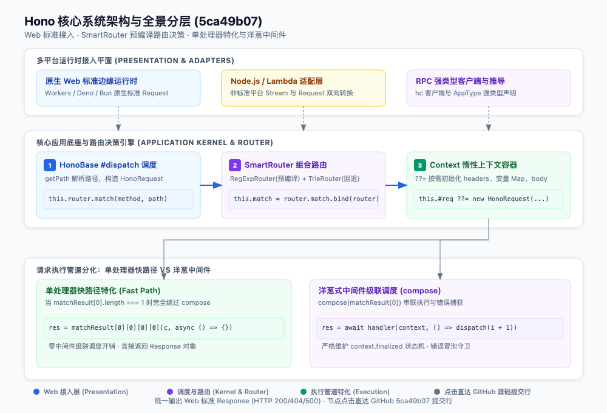
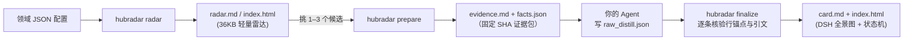

<div align="center">

# HubRadar

**发现增长黑马，拆解架构核心，拒绝重复造轮子。**

先用领域雷达看清一个方向上谁在加速，再把选中的仓库蒸馏成一张三分钟卡片。<br>
卡片上的每条结论都钉在固定提交的源码行上，点开就能核对。

[在线画廊](#画廊) · [30 秒上手](#30-秒上手) · [双轮驱动](#双轮驱动) · [Agent Skills](#agent-skills) · [Dogfood 历程](#dogfood-历程) · [能力边界](#能力边界)

<br>

<a href="gallery/honojs__hono/index.html">
  
</a>

<p align="center"><i>HubRadar 自动生成的 Hono 架构全景图（固定提交 5ca49b07）。每个模块和代码胶囊都内嵌 GitHub 源码行超链接，点击直接跳到对应实现。</i></p>

</div>

---

```text
honojs/hono @ 5ca49b07 · 3 分钟卡片
覆盖：源码 232 文件 · 证据包约 23,075 tokens / 全量约 236,440 · 结论校验 32/32 通过

本质：Hono = Web 标准 Request/Response + 可替换的路由策略（默认 SmartRouter 组合
      RegExpRouter/TrieRouter）+ 洋葱式中间件 compose；单处理器请求走绕过 compose 的快路径。
      [作者声明✓ README.md#L21] [源码事实✓ hono.ts#L20] [源码事实✓ hono-base.ts#L437] …

判断：用 + 借鉴
```

## HubRadar 是什么

HubRadar 是一个专注**开源技术选型与架构拆解**的 Python 命令行工具，外加两份 Agent Skills。数据采集、排序分析、引文校验和离线排版由本地引擎完成；深度阅读代码、做出工程判断的是你已经在用的 AI Agent（Claude Code、Codex、Cursor、Qoder 等）。HubRadar 自己不硬编码任何私有模型 API，也不需要额外的 API Key。

```sh
hubradar radar my-domain.json -o out/radar --html             # 领域雷达：找轮子、看加速度、标出可疑热度
hubradar prepare ~/src/hono --repo honojs/hono -o work/hono   # 蒸馏第 1 步：从 Git HEAD 挑出约 2 万 token 的核心证据包
#   …… Agent 阅读 evidence.md，写出 raw_distill.json ……
hubradar finalize work/hono --source ~/src/hono -o out/hono --html   # 蒸馏第 2 步：逐条核验锚点，生成卡片与 DSH 白皮书
hubradar arch --example hubradar -o out/arch.svg              # 官方 Benchmark 样例（也可选 hono；无参数时默认 hono）
hubradar arch --spec architecture.json -o out/system.svg     # 语义 JSON 自动布局；文件缺失或输入无效时退出码为 2
hubradar html out/hono/card.md                                 # 格式转换：任意 card.md / radar.md 转换为独立离线单文件 HTML
```

DSH 仅使用 Python 标准库；调用方提供 `layers`、`cards`、`edges`，无需坐标。画布宽 1000px，高度随内容增长，四张卡片自动排成 2×2。已有显式坐标与 `connectors` 仍可使用：

```json
{
  "title": "系统架构全景",
  "layers": [
    {"id": "ingress", "name": "接入平面", "cards": [
      {"id": "cli", "title": "统一 CLI 网关", "desc": "命令分流", "code_pill": "main(sys.argv)", "color": "blue", "href": "https://github.com/owner/repo/blob/SHA/cli.py#L1"}
    ]},
    {"id": "kernel", "name": "执行平面", "cards": [
      {"id": "prepare", "title": "证据准备", "desc": "静态分析", "color": "emerald"}
    ]}
  ],
  "edges": [{"from": "cli", "to": "prepare", "style": "dashed", "color": "#94a3b8"}]
}
```

在 Markdown 的 `dsh`、`architecture` 或 `dsh-architecture` 围栏中放入该 JSON 即可生成报告图解；`hubradar` / `hono` 标签仅加载明确标注的 Benchmark。无效 JSON、渲染异常和原始 SVG 会显示告警卡片及可展开原文，不会替换成其他项目的图。



## 双轮驱动

### 🛰 领域雷达：找轮子、看加速度、防刷星

- **找轮子**：一份领域 JSON 写清 seed 仓库和 GitHub 组合检索条件。候选经 GraphQL 批量补全后，自动划分为**爆发、新星、基石、主流/长尾、衰退/沉寂**五个梯队（历史数据不足的列为“趋势未知”），再用 topic 共现聚类绘出领域版图。排名前 40 的候选还会补查 [ecosyste.ms](https://ecosyste.ms) 的实际依赖包数与月下载量，这是 Star 之外更真实的工业采用信号。
- **看加速度**：只看总 Star，老牌项目会长期霸榜。HubRadar 读取 GitHub `stargazers/history` 周级增长曲线，用近 7 天新增除以前 8 周的周增量中位数计算“真实加速度”。加速度不低于 3、周增量进入本领域前 10% 且不少于 200，才判定为“爆发”，并附带 12 周迷你火花线。
- **防刷星**：2026 年起，GitHub 的 stargazer 列表接口对非协作者返回 404，逐账号排查已不可行。HubRadar 改用聚合行为特征审计：Star 过五千的仓库，检查 Fork/Star 比是否低于 0.5%、是否一个 Open Issue 都没有、90 天内提交是否少于 5 次；建库不到 30 天的仓库，检查是否在 7 天内突增 80% Star。命中者标为“待核验”，实事求是提示风险。

### 🔬 架构蒸馏：拆轮子、DSH 交互式白皮书、逐字 SHA 锚点

- **拆轮子**：`prepare` 只读本地 Git committed HEAD，用 ast-grep 静态解析 Import 依赖，在依赖拓扑图上跑 PageRank（以入口文件和测试用例为起点），再叠加高频改动加分与核心模式加分，剔除适配器、barrel 导出与纯类型文件。最后按预算打包装袋：Hono 全量约 23.6 万 token，核心证据包收敛至 2.3 万（约 9.8%）。
- **逐字 SHA 锚点**：Agent 写下的每条“源码事实”和“作者声明”都必须携带精确行区间与逐字代码引文：

  ```json
  {
    "type": "源码事实",
    "text": "只匹配到一个处理器时直接调用它，完全绕过 compose 中间件引擎。",
    "anchors": [{
      "path": "src/hono-base.ts",
      "start": 449,
      "end": 466,
      "quote": "if (matchResult[0].length === 1) {"
    }]
  }
  ```

  `finalize` 回到固定提交逐字比对。文件不存在、行号越界、引文不符，任何一项校验失败均以非零退出码阻断。社区信号必须绑定采集到的 Issue；推断必须归入“报告综合”或“批判审计”，严禁将猜想冒充为源码事实。
- **DSH 交互式白皮书**：卡片与雷达均可导出为自包含的单文件 HTML。版式严格遵循 DeepSeek Harness（DSH）白皮书设计语言：1000px 响应式盒模型、浅色优雅排版、彩色工序标签、深色代码块，支持深浅色主题平滑切换、表格点击排序、仓库实时检索过滤、详情折叠、图形矢量无级缩放与打印适配。页面 CSP 策略禁止一切外部资源请求，**断网完全可用**。

## 画廊

| 样例 | 规模与性能 | 核心看点 |
|---|---|---|
| **[Hono 三分钟架构卡片](gallery/honojs__hono/card.md)**<br>[交互式白皮书 HTML](gallery/honojs__hono/index.html) | 232 个源码文件 → 2.3 万 token 证据包 → 32 条结论，全部通过严格校验 | 主数据流分层、SmartRouter 状态机、69 行 MVP 骨架、架构权衡、阅读路线、点击直达固定提交行 |
| **[代码理解工具领域雷达](gallery/code-intel-for-agents/radar.md)**<br>[交互式雷达 HTML](gallery/code-intel-for-agents/index.html) | 111 个候选 → 74 行入表，单文件仅 **36KB**，耗时约 4 分钟 | 基石：Graphify、Aider、Repomix、gitingest；新星 7 个；无冗余脚本内联，极速秒开 |

> *注：两份样例均为 2026-10 的固定提交快照，请下载 HTML 后直接在浏览器双击打开。*

## 30 秒上手

**0. 体验成品：** 下载并直接用浏览器双击打开画廊里的两个 HTML。

**1. 一键安装 CLI：** 需要 Python 3.10+ 和 Git，推荐使用现代包管理器 [uv](https://github.com/astral-sh/uv)：

```sh
uv tool install --editable .
hubradar --version
```

`uv tool` 会将 `hubradar` 注入至 `~/.local/bin`，新建 Shell 即可全局可用。也可用原生 venv：`python3 -m venv .venv && source .venv/bin/activate && pip install -e .`。

**2. 第一条命令，秒出白皮书：**

```sh
# 将样例卡片渲染为离线交互式白皮书
hubradar html gallery/honojs__hono/card.md -o /tmp/hono.html && open /tmp/hono.html
```

**3. 蒸馏你自己选的仓库：**

```sh
hubradar prepare /path/to/repo --repo owner/repo -o work/repo     # 加 --offline 跳过在线社区信号
# 让你的 Agent（Claude Code / Codex / Cursor）阅读 work/repo/evidence.md，完成 raw_distill.json
hubradar finalize work/repo --source /path/to/repo -o out/repo --html
```

`prepare` 不运行目标代码的安装、构建或测试，未提交变更不会进入证据包。

**4. 跑一张自己的领域雷达：** 复制 [domains/code-intel-for-agents.json](domains/code-intel-for-agents.json)，修改为你关注的技术方向：

```sh
gh auth login                                   # 雷达数据采集需要已认证的 GitHub CLI
hubradar radar my-domain.json -o out/my-domain --html
```

## Agent Skills

| Skill 模块 | 职责与适用场景 | 触发方式举例 |
|---|---|---|
| [`hubradar`](skills/hubradar/SKILL.md) | 仓库核心架构蒸馏 | “蒸馏 ~/src/hono（honojs/hono），我想彻底搞清楚它的路由为何比别人快” |
| [`hubradar-radar`](skills/hubradar-radar/SKILL.md) | 领域前沿探索与雷达扫描 | “调研给 Agent 用的代码理解工具，找出最近在加速的黑马项目” |

两份 Skill 均直接调用本机的 `hubradar` 命令。安装至宿主：

```sh
mkdir -p ~/.agents/skills ~/.claude/skills
for s in hubradar hubradar-radar; do
  ln -sfn "$PWD/skills/$s" ~/.agents/skills/$s    # Codex, Cursor
  ln -sfn "$PWD/skills/$s" ~/.claude/skills/$s    # Claude Code
done
```

## Dogfood 历程

“拒绝重复造轮子”是 HubRadar 倡导的理念，也是我们自研过程中的反思准绳。

### 从手写排版器翻车，到批判性融合 DSH 盒模型

```text
第 1 代：90 行手写排版器  ──>  第 2 代：全量内联 Mermaid  ──>  第 3 代：原生 DSH 盒模型引擎
• 画布被拉伸至 2465px           • 解决了溢出与文字折叠          • 汲取 Fire 1000px 黄金视口与 C4 盒模型
• 节点文字被硬折行截断           • 产生 3.4MB 脚本内联负担        • 汲取 Archify 逐字 SHA 锚点 (Click-to-Source)
• 读者需要横向滚动两屏           • 全景图退化为垂直“糖葫芦串”    • 彻底剔除冗余依赖，单图 10KB，雷达仅 36KB
```

1. **第 1 代（自研轮子翻车）**：第一版白皮书使用了一个约 90 行的拓扑排版脚本。一跑 Hono 卡片，9 个节点横向排成 8 列，画布被拉爆至 2465px 宽，文字被无情硬截断成 `Web Req` 和 `uest）`。读者读一张图要横向滑两屏。我们在已有成熟解法的地方盲目自研，结结实实栽了跟头。
2. **第 2 代（全量内联 Mermaid 的代价）**：我们迅速替换为开源标杆 Mermaid 11.17.2，解决了折行和自适应问题。但这带来了新的代价：每份原本几十 KB 的离线 HTML 都被迫塞入 3.4MB 的 Mermaid 引擎；更致命的是，复杂的系统全景图在 Mermaid 默认流式布局下被拉成一根长长的垂直“糖葫芦串”，缺乏工业级系统自上而下的分层容器感。
3. **第 3 代（批判性学习 Fire 与 Archify，自研 DSH 盒模型）**：
   - **批判学习 Fire Skill**：吸收其 C4 盒模型几何规范（1000px 视口、接入层/内核调度层/执行管道层、数字工序徽章、等宽代码胶囊），但**断然抛弃**其 12 种冗余风格及 cairosvg、node 等外部重度依赖；
   - **批判学习 Archify**：吸收其 Click-to-Source 源码锚点（`<a href="...#L...">`）与 CSS 变量主题代币，但**断然抛弃**其沉重的 WebGL 客户端图运行时；
   - **双模型交叉审计收敛**：通过 OpenAI Codex 与 Qoder（YOLO 模式）进行多轮深度交叉审计，抓出了行号越界（`client/index.ts` 17 行越界）、代码胶囊非逐字真实代码（纠正为真实 `matchResult[0].length === 1` 与 `compose.ts:51` 级联）、首层卡片 17px 文字溢出、以及 Bleach 探针发现的标签过滤缺陷（通过安全的占位符机制保护矢量标签）；
   - **最终成果**：内置纯 Python、零外部依赖的 `dsh_architecture` 原生引擎。在无 Mermaid 需求的页面（如领域雷达），页面体积从 3.6MB 骤降至 **36KB**；在架构白皮书首屏，默认呈现 DSH 级全景交互图，所有卡片均可点击直达 GitHub 源码提交行。

## 能力边界

- **✓ 只证明引文字面对得上**：它说明这句话确实出自该提交的那几行代码，不保证推断绝对正确，也不替代单元测试。
- **“三分钟”是阅读卡片的目标，不是分析耗时**：Hono 这一轮，Agent 提炼核心逻辑耗时约 77 秒，读证据包时间另计。
- **语言覆盖演进中**：JS/TS 支持最完整；Python 已覆盖主流静态规则；Go 目前跨文件依赖尚未深层展开。
- **MVP 骨架用于教学**：省略了异常取消、并发安全与边界防护，切勿直接贴入生产环境。
- **白皮书要求浏览器开启 JS**：图形缩放、表格即时排序、筛选与深浅色模式切换依赖内联脚本，不发任何网络请求。

## 开源致谢与许可证

- [Mermaid](https://github.com/mermaid-js/mermaid) (MIT)：负责白皮书里的状态机图与备选流程图排版。
- [ast-grep](https://github.com/ast-grep/ast-grep)、[NetworkX](https://github.com/networkx/networkx)、[markdown-it-py](https://github.com/executablebooks/markdown-it-py)、[bleach](https://github.com/mozilla/bleach)：HubRadar 的核心分析依赖。
- 项目源码托管于 GitHub：[`Li-Sanze/hubradar`](https://github.com/Li-Sanze/hubradar)。
- 许可证：本项目采用 MIT 许可证，`hubradar/assets/vendor/` 内置库遵循原作者开源协议。
