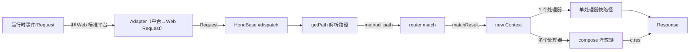
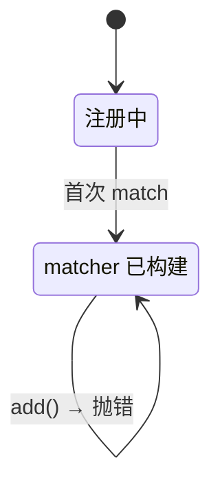
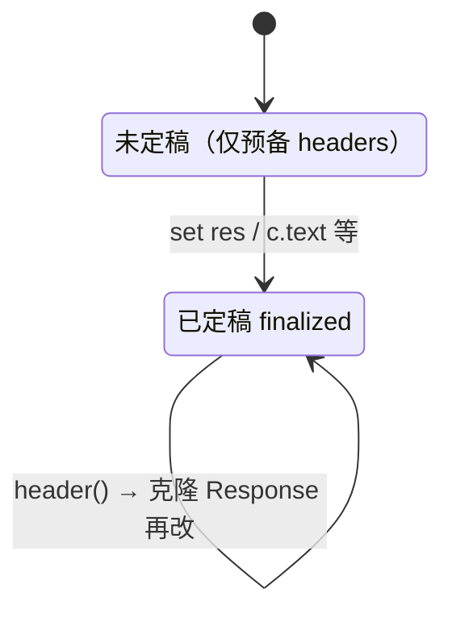

# honojs/hono @ `5ca49b07` · 3 分钟卡片
> 覆盖：full_scan（源码 232 文件）· 证据包约 23,075 tokens / 全量约 236,440 · 结论校验 32/32 通过

**本质**：Hono = Web 标准 Request/Response + 可替换的路由策略（默认 SmartRouter 组合 RegExpRouter/TrieRouter）+ 洋葱式中间件 compose；单处理器请求走绕过 compose 的快路径。 [作者声明✓ README.md#L21](https://github.com/honojs/hono/blob/5ca49b0720755c585c9a9835f0a479ceea36fb52/README.md#L21-L21) [源码事实✓ hono.ts#L20](https://github.com/honojs/hono/blob/5ca49b0720755c585c9a9835f0a479ceea36fb52/src/hono.ts#L20-L32) [源码事实✓ hono-base.ts#L437](https://github.com/honojs/hono/blob/5ca49b0720755c585c9a9835f0a479ceea36fb52/src/hono-base.ts#L437-L446) [源码事实✓ hono-base.ts#L449](https://github.com/honojs/hono/blob/5ca49b0720755c585c9a9835f0a479ceea36fb52/src/hono-base.ts#L449-L466) [源码事实✓ hono-base.ts#L242](https://github.com/honojs/hono/blob/5ca49b0720755c585c9a9835f0a479ceea36fb52/src/hono-base.ts#L242-L243)

**解决**：在任意 JS 运行时（Workers/Deno/Bun/Node/Lambda）上用同一套代码写 HTTP API，并获得强类型的路由与 RPC 客户端。  
**不解决**：不提供 Express 中间件兼容层，也不内置 OpenAPI 文档生成（均为高票未关闭需求）。 [社区信号✓ #3293](https://github.com/honojs/hono/issues/3293) [社区信号✓ #2970](https://github.com/honojs/hono/issues/2970)

## 核心抽象
| 抽象 | 职责 | 证据 |
|---|---|---|
| Hono / HonoBase（应用） | 注册路由与中间件，持有 router，#dispatch 把 Request 变成 Response | [源码事实✓ hono-base.ts#L144](https://github.com/honojs/hono/blob/5ca49b0720755c585c9a9835f0a479ceea36fb52/src/hono-base.ts#L144-L158) [源码事实✓ hono-base.ts#L175](https://github.com/honojs/hono/blob/5ca49b0720755c585c9a9835f0a479ceea36fb52/src/hono-base.ts#L175-L186) [源码事实✓ hono-base.ts#L405](https://github.com/honojs/hono/blob/5ca49b0720755c585c9a9835f0a479ceea36fb52/src/hono-base.ts#L405-L416) [源码事实✓ hono-base.ts#L437](https://github.com/honojs/hono/blob/5ca49b0720755c585c9a9835f0a479ceea36fb52/src/hono-base.ts#L437-L446) |
| Router<T>（路由策略接口） | add/match 两个方法；多实现可替换，默认 SmartRouter 组合两种实现 | [源码事实✓ router.ts#L29](https://github.com/honojs/hono/blob/5ca49b0720755c585c9a9835f0a479ceea36fb52/src/router.ts#L29-L52) [源码事实✓ hono.ts#L20](https://github.com/honojs/hono/blob/5ca49b0720755c585c9a9835f0a479ceea36fb52/src/hono.ts#L20-L32) |
| Context（请求上下文） | 惰性持有 req/res/变量 Map，提供 c.text/c.json 等响应构造，并维护 finalized 状态 | [源码事实✓ context.ts#L366](https://github.com/honojs/hono/blob/5ca49b0720755c585c9a9835f0a479ceea36fb52/src/context.ts#L366-L369) [源码事实✓ context.ts#L414](https://github.com/honojs/hono/blob/5ca49b0720755c585c9a9835f0a479ceea36fb52/src/context.ts#L414-L434) [源码事实✓ context.ts#L557](https://github.com/honojs/hono/blob/5ca49b0720755c585c9a9835f0a479ceea36fb52/src/context.ts#L557-L560) |
| HonoRequest（请求包装） | 按 matchResult 解析路径参数，缓存 body，供校验器写入已验证数据 | [源码事实✓ request.ts#L217](https://github.com/honojs/hono/blob/5ca49b0720755c585c9a9835f0a479ceea36fb52/src/request.ts#L217-L244) [源码事实✓ request.ts#L103](https://github.com/honojs/hono/blob/5ca49b0720755c585c9a9835f0a479ceea36fb52/src/request.ts#L103-L107) |
| compose（中间件内核） | 把匹配到的处理器链组装成洋葱模型；单处理器时被绕过 | [源码事实✓ hono-base.ts#L242](https://github.com/honojs/hono/blob/5ca49b0720755c585c9a9835f0a479ceea36fb52/src/hono-base.ts#L242-L243) [源码事实✓ hono-base.ts#L449](https://github.com/honojs/hono/blob/5ca49b0720755c585c9a9835f0a479ceea36fb52/src/hono-base.ts#L449-L466) |

## 主数据流与系统全景
```dsh-architecture
{
  "slug": "hono",
  "title": "Hono 核心系统架构与全景分层 (5ca49b07)",
  "subtitle": "Web 标准接入 · SmartRouter 预编译路由决策 · 单处理器特化与洋葱中间件",
  "layers": [
    {
      "id": "adapters",
      "name": "多平台运行时接入平面 (Presentation & Adapters)",
      "cards": [
        {
          "id": "web",
          "title": "原生 Web 标准边缘运行时",
          "desc": "Workers / Deno / Bun 原生标准 Request",
          "color": "blue",
          "href": "https://github.com/honojs/hono/blob/5ca49b0720755c585c9a9835f0a479ceea36fb52/src/hono.ts#L20-L32"
        },
        {
          "id": "adapters",
          "title": "Node.js / Lambda 适配层",
          "desc": "非标准平台 Stream 与 Request 双向转换",
          "color": "yellow",
          "href": "https://github.com/honojs/hono/blob/5ca49b0720755c585c9a9835f0a479ceea36fb52/src/adapter/aws-lambda/handler.ts#L1-L25"
        },
        {
          "id": "rpc",
          "title": "RPC 强类型客户端与推导",
          "desc": "hc 客户端与 AppType 强类型声明",
          "color": "purple",
          "href": "https://github.com/honojs/hono/blob/5ca49b0720755c585c9a9835f0a479ceea36fb52/src/client/index.ts#L1-L17"
        }
      ]
    },
    {
      "id": "kernel",
      "name": "核心应用底座与路由决策引擎 (Application Kernel & Router)",
      "cards": [
        {
          "badge": "1",
          "id": "dispatch",
          "title": "HonoBase #dispatch 调度",
          "desc": "getPath 解析路径，构造 HonoRequest",
          "code_pill": "this.router.match(method, path)",
          "color": "blue",
          "href": "https://github.com/honojs/hono/blob/5ca49b0720755c585c9a9835f0a479ceea36fb52/src/hono-base.ts#L437-L448"
        },
        {
          "badge": "2",
          "id": "router",
          "title": "SmartRouter 组合路由",
          "desc": "RegExpRouter(预编译) + TrieRouter(回退)",
          "code_pill": "this.match = router.match.bind(router)",
          "color": "purple",
          "href": "https://github.com/honojs/hono/blob/5ca49b0720755c585c9a9835f0a479ceea36fb52/src/router/smart-router/router.ts#L21-L49"
        },
        {
          "badge": "3",
          "id": "context",
          "title": "Context 惰性上下文容器",
          "desc": "??= 按需初始化 headers、变量 Map、body",
          "code_pill": "this.#req ??= new HonoRequest(...)",
          "color": "emerald",
          "href": "https://github.com/honojs/hono/blob/5ca49b0720755c585c9a9835f0a479ceea36fb52/src/context.ts#L366-L407"
        }
      ]
    },
    {
      "id": "execution",
      "name": "执行管道特化：快路径 VS compose",
      "cards": [
        {
          "id": "fast-path",
          "title": "单处理器快路径特化 (Fast Path)",
          "desc": "当 matchResult[0].length === 1 时完全绕过 compose",
          "code_pill": "res = matchResult[0][0][0][0](c, async () => {})",
          "pill_desc": "零中间件级联调度开销 · 直接返回 Response 对象",
          "color": "emerald",
          "href": "https://github.com/honojs/hono/blob/5ca49b0720755c585c9a9835f0a479ceea36fb52/src/hono-base.ts#L449-L466"
        },
        {
          "id": "compose",
          "title": "洋葱式中间件级联调度 (compose)",
          "desc": "compose(matchResult[0]) 串联执行与错误捕获",
          "code_pill": "res = await handler(context, () => dispatch(i + 1))",
          "pill_desc": "严格维护 context.finalized 状态机 · 错误冒泡守卫",
          "color": "purple",
          "href": "https://github.com/honojs/hono/blob/5ca49b0720755c585c9a9835f0a479ceea36fb52/src/compose.ts#L32-L71"
        }
      ]
    }
  ],
  "edges": [
    {
      "from": "web",
      "to": "dispatch",
      "style": "dashed"
    },
    {
      "from": "adapters",
      "to": "dispatch",
      "style": "dashed"
    },
    {
      "from": "rpc",
      "to": "dispatch",
      "style": "dashed"
    },
    {
      "from": "dispatch",
      "to": "router"
    },
    {
      "from": "router",
      "to": "context"
    },
    {
      "from": "context",
      "to": "fast-path"
    },
    {
      "from": "context",
      "to": "compose"
    }
  ],
  "legend": {
    "items": [
      {
        "label": "Web 接入层 (Presentation)",
        "color": "#2563eb"
      },
      {
        "label": "调度与路由 (Kernel & Router)",
        "color": "#7c3aed"
      },
      {
        "label": "执行管道特化 (Execution)",
        "color": "#059669"
      },
      {
        "label": "点击直达 GitHub 源码提交行",
        "color": "#64748b"
      }
    ]
  },
  "summary_note": "统一输出 Web 标准 Response (HTTP 200/404/500) · 节点点击直达 GitHub 5ca49b07 提交行"
}
```
<details><summary>查看 Mermaid 原始流程图</summary>



</details>

## 状态机
**Router 生命周期（注册期 → 已构建）** [源码事实✓ router.ts#L21](https://github.com/honojs/hono/blob/5ca49b0720755c585c9a9835f0a479ceea36fb52/src/router.ts#L21-L22)

**Context 响应状态** [源码事实✓ context.ts#L414](https://github.com/honojs/hono/blob/5ca49b0720755c585c9a9835f0a479ceea36fb52/src/context.ts#L414-L434) [源码事实✓ context.ts#L519](https://github.com/honojs/hono/blob/5ca49b0720755c585c9a9835f0a479ceea36fb52/src/context.ts#L519-L522)


## 承重模式
- **洋葱式中间件（compose + await next()）**：所有中间件与子应用错误处理都经由 compose 串联；内置中间件 36 处 await next() [源码事实✓ hono-base.ts#L242](https://github.com/honojs/hono/blob/5ca49b0720755c585c9a9835f0a479ceea36fb52/src/hono-base.ts#L242-L243) [源码事实✓ index.ts#L113](https://github.com/honojs/hono/blob/5ca49b0720755c585c9a9835f0a479ceea36fb52/src/middleware/basic-auth/index.ts#L113-L113)
- **策略 + 组合（Router 接口 + SmartRouter）**：性能与兼容性的取舍被封装在可替换的路由实现里 [源码事实✓ router.ts#L29](https://github.com/honojs/hono/blob/5ca49b0720755c585c9a9835f0a479ceea36fb52/src/router.ts#L29-L52) [源码事实✓ hono.ts#L20](https://github.com/honojs/hono/blob/5ca49b0720755c585c9a9835f0a479ceea36fb52/src/hono.ts#L20-L32)
- **惰性初始化（??= / ||=）**：req、res、变量 Map、body 都按需创建，降低每请求分配 [源码事实✓ context.ts#L366](https://github.com/honojs/hono/blob/5ca49b0720755c585c9a9835f0a479ceea36fb52/src/context.ts#L366-L369) [源码事实✓ context.ts#L557](https://github.com/honojs/hono/blob/5ca49b0720755c585c9a9835f0a479ceea36fb52/src/context.ts#L557-L560) [源码事实✓ request.ts#L217](https://github.com/honojs/hono/blob/5ca49b0720755c585c9a9835f0a479ceea36fb52/src/request.ts#L217-L244) [源码事实✓ context.ts#L403](https://github.com/honojs/hono/blob/5ca49b0720755c585c9a9835f0a479ceea36fb52/src/context.ts#L403-L407)
- **快路径特化**：只有一个处理器时跳过 compose，直接调用 [源码事实✓ hono-base.ts#L449](https://github.com/honojs/hono/blob/5ca49b0720755c585c9a9835f0a479ceea36fb52/src/hono-base.ts#L449-L466)

## 架构权衡
- 选了 **只依赖 Web 标准 API、零依赖**，放弃 Node 等非标准平台需要 adapter 转换；代价：adapter 层持续维护（近一年改动最多的文件是 aws-lambda handler） [作者声明✓ README.md#L21](https://github.com/honojs/hono/blob/5ca49b0720755c585c9a9835f0a479ceea36fb52/README.md#L21-L21) [作者声明✓ README.md#L43](https://github.com/honojs/hono/blob/5ca49b0720755c585c9a9835f0a479ceea36fb52/README.md#L43-L43) 〔报告综合✓〕
- 选了 **RegExpRouter 预编译匹配器追求速度**，放弃 构建后不能再注册路由；部分路径模式不支持；代价：需要 SmartRouter 用 TrieRouter 兜底 [作者声明✓ README.md#L42](https://github.com/honojs/hono/blob/5ca49b0720755c585c9a9835f0a479ceea36fb52/README.md#L42-L42) [源码事实✓ router.ts#L21](https://github.com/honojs/hono/blob/5ca49b0720755c585c9a9835f0a479ceea36fb52/src/router.ts#L21-L22) [源码事实✓ router.ts#L103](https://github.com/honojs/hono/blob/5ca49b0720755c585c9a9835f0a479ceea36fb52/src/router.ts#L103-L103) [源码事实✓ hono.ts#L20](https://github.com/honojs/hono/blob/5ca49b0720755c585c9a9835f0a479ceea36fb52/src/hono.ts#L20-L32)
- 选了 **重度类型体操换取类型推导与 RPC 客户端**，放弃 类型实现复杂度（types.ts 约 2660 行）；代价：RPC 在中间件响应、SSE 等场景的类型覆盖长期是高票需求 [批判审计✓ types.ts#L35](https://github.com/honojs/hono/blob/5ca49b0720755c585c9a9835f0a479ceea36fb52/src/types.ts#L35-L35) [社区信号✓ #2719](https://github.com/honojs/hono/issues/2719)

## 最小 MVP 骨架
<details><summary>约 70 行 TypeScript：把 Hono 的内核压缩成可读骨架（展开）</summary>

```ts
type Next = () => Promise<void>
type Handler = (c: Ctx, next: Next) => Response | void | Promise<Response | void>

class Ctx {
  res?: Response
  finalized = false
  #vars?: Map<string, unknown>
  constructor(public req: Request, public params: Record<string, string>) {}
  set(k: string, v: unknown) { (this.#vars ??= new Map()).set(k, v) }
  get(k: string) { return this.#vars?.get(k) }
  text(body: string, status = 200) {
    this.res = new Response(body, { status })
    this.finalized = true
    return this.res
  }
}

function compose(handlers: Handler[]) {
  return async (c: Ctx) => {
    let last = -1
    const run = async (i: number): Promise<void> => {
      if (i <= last) throw new Error('next() called multiple times')
      last = i
      const h = handlers[i]
      if (!h) return
      const r = await h(c, () => run(i + 1))
      if (r instanceof Response) { c.res = r; c.finalized = true }
    }
    await run(0)
    return c
  }
}

interface Router<T> { add(m: string, p: string, h: T): void; match(m: string, p: string): [T, Record<string, string>][] }

class LinearRouter<T> implements Router<T> {
  #routes: [string, RegExp, string[], T][] = []
  add(m: string, p: string, h: T) {
    const keys: string[] = []
    const re = new RegExp('^' + p.replace(/\*/g, '.*').replace(/:(\w+)/g, (_, k) => (keys.push(k), '([^/]+)')) + '$')
    this.#routes.push([m, re, keys, h])
  }
  match(m: string, p: string) {
    const out: [T, Record<string, string>][] = []
    for (const [rm, re, keys, h] of this.#routes) {
      const hit = (rm === 'ALL' || rm === m) && re.exec(p)
      if (hit) out.push([h, Object.fromEntries(keys.map((k, i) => [k, hit[i + 1]]))])
    }
    return out
  }
}

export class MiniHono {
  router: Router<Handler> = new LinearRouter<Handler>()
  get(path: string, ...hs: Handler[]) { hs.forEach((h) => this.router.add('GET', path, h)); return this }
  use(...hs: Handler[]) { hs.forEach((h) => this.router.add('ALL', '*', h)); return this }
  fetch = async (req: Request): Promise<Response> => {
    const path = new URL(req.url).pathname
    const matched = this.router.match(req.method, path)
    const c = new Ctx(req, matched.at(-1)?.[1] ?? {})
    const notFound = () => new Response('404 Not Found', { status: 404 })
    if (matched.length === 1) {
      return (await matched[0][0](c, async () => {})) ?? c.res ?? notFound()
    }
    await compose(matched.map(([h]) => h))(c)
    return c.res ?? notFound()
  }
}
```

- 第 4-16 行 ↔ [源码事实✓ context.ts#L366](https://github.com/honojs/hono/blob/5ca49b0720755c585c9a9835f0a479ceea36fb52/src/context.ts#L366-L369) [源码事实✓ context.ts#L414](https://github.com/honojs/hono/blob/5ca49b0720755c585c9a9835f0a479ceea36fb52/src/context.ts#L414-L434) [源码事实✓ context.ts#L557](https://github.com/honojs/hono/blob/5ca49b0720755c585c9a9835f0a479ceea36fb52/src/context.ts#L557-L560)
- 第 18-32 行 ↔ [源码事实✓ hono-base.ts#L242](https://github.com/honojs/hono/blob/5ca49b0720755c585c9a9835f0a479ceea36fb52/src/hono-base.ts#L242-L243) [报告综合✓ hono-base.ts#L7](https://github.com/honojs/hono/blob/5ca49b0720755c585c9a9835f0a479ceea36fb52/src/hono-base.ts#L7-L7)
- 第 34-53 行 ↔ [源码事实✓ router.ts#L29](https://github.com/honojs/hono/blob/5ca49b0720755c585c9a9835f0a479ceea36fb52/src/router.ts#L29-L52)
- 第 55-71 行 ↔ [源码事实✓ hono-base.ts#L144](https://github.com/honojs/hono/blob/5ca49b0720755c585c9a9835f0a479ceea36fb52/src/hono-base.ts#L144-L158) [源码事实✓ hono-base.ts#L175](https://github.com/honojs/hono/blob/5ca49b0720755c585c9a9835f0a479ceea36fb52/src/hono-base.ts#L175-L186) [源码事实✓ hono-base.ts#L437](https://github.com/honojs/hono/blob/5ca49b0720755c585c9a9835f0a479ceea36fb52/src/hono-base.ts#L437-L446) [源码事实✓ hono-base.ts#L449](https://github.com/honojs/hono/blob/5ca49b0720755c585c9a9835f0a479ceea36fb52/src/hono-base.ts#L449-L466)
</details>

## 避坑
- 路由必须在首个请求前注册完：matcher 构建后再 add 会抛错（动态注册路由的项目要注意）。 [源码事实✓ router.ts#L21](https://github.com/honojs/hono/blob/5ca49b0720755c585c9a9835f0a479ceea36fb52/src/router.ts#L21-L22)
- 不要直接消费 c.req.raw 的 body；用 req.json()/req.text() 等带缓存的方法，否则后续克隆请求会 500。 [源码事实✓ request.ts#L486](https://github.com/honojs/hono/blob/5ca49b0720755c585c9a9835f0a479ceea36fb52/src/request.ts#L486-L491)
- 响应定稿后再改 header 会克隆整个 Response：中间件里尽量在 next() 之前设置头。 [源码事实✓ context.ts#L519](https://github.com/honojs/hono/blob/5ca49b0720755c585c9a9835f0a479ceea36fb52/src/context.ts#L519-L522)
- Express 中间件不能直接复用（兼容层仍是开放需求）；从 v3 起 c.req 是 HonoRequest，升级旧代码先看迁移指南。 [社区信号✓ #3293](https://github.com/honojs/hono/issues/3293) [作者声明✓ MIGRATION.md#L64](https://github.com/honojs/hono/blob/5ca49b0720755c585c9a9835f0a479ceea36fb52/docs/MIGRATION.md#L64-L64)

## 可以偷的点
- 单处理器快路径：命中只有一个 handler 时完全绕过中间件引擎。 [源码事实✓ hono-base.ts#L449](https://github.com/honojs/hono/blob/5ca49b0720755c585c9a9835f0a479ceea36fb52/src/hono-base.ts#L449-L466)
- 用 ??= 惰性创建每请求对象（req 包装、Headers、变量 Map、body 缓存）。 [源码事实✓ context.ts#L366](https://github.com/honojs/hono/blob/5ca49b0720755c585c9a9835f0a479ceea36fb52/src/context.ts#L366-L369) [源码事实✓ context.ts#L557](https://github.com/honojs/hono/blob/5ca49b0720755c585c9a9835f0a479ceea36fb52/src/context.ts#L557-L560) [源码事实✓ request.ts#L217](https://github.com/honojs/hono/blob/5ca49b0720755c585c9a9835f0a479ceea36fb52/src/request.ts#L217-L244) [源码事实✓ context.ts#L403](https://github.com/honojs/hono/blob/5ca49b0720755c585c9a9835f0a479ceea36fb52/src/context.ts#L403-L407)
- 把路由做成策略接口，再用组合路由在快实现失败时回退到通用实现。 [源码事实✓ hono.ts#L20](https://github.com/honojs/hono/blob/5ca49b0720755c585c9a9835f0a479ceea36fb52/src/hono.ts#L20-L32) [源码事实✓ router.ts#L29](https://github.com/honojs/hono/blob/5ca49b0720755c585c9a9835f0a479ceea36fb52/src/router.ts#L29-L52) [源码事实✓ router.ts#L103](https://github.com/honojs/hono/blob/5ca49b0720755c585c9a9835f0a479ceea36fb52/src/router.ts#L103-L103)
- 热路径上手写 charCode 扫描解析 URL 路径，避免 new URL() 的开销。 [源码事实✓ url.ts#L106](https://github.com/honojs/hono/blob/5ca49b0720755c585c9a9835f0a479ceea36fb52/src/utils/url.ts#L106-L134)

## 判断：用 + 借鉴
做多运行时/边缘 HTTP API 可直接用；造自己的框架或中间件系统时，compose 内核、路由策略与快路径值得照搬。

## 阅读路线
1. [`src/hono.ts`](https://github.com/honojs/hono/blob/5ca49b0720755c585c9a9835f0a479ceea36fb52/src/hono.ts) — 33 行看清默认装配：HonoBase + SmartRouter
2. [`src/hono-base.ts`](https://github.com/honojs/hono/blob/5ca49b0720755c585c9a9835f0a479ceea36fb52/src/hono-base.ts) — #addRoute 与 #dispatch：请求主路径
3. [`src/compose.ts`](https://github.com/honojs/hono/blob/5ca49b0720755c585c9a9835f0a479ceea36fb52/src/compose.ts) — 洋葱模型内核（证据包只含签名，需回原文）
4. [`src/context.ts`](https://github.com/honojs/hono/blob/5ca49b0720755c585c9a9835f0a479ceea36fb52/src/context.ts) — 惰性对象与 finalized 语义
5. [`src/router/smart-router/router.ts`](https://github.com/honojs/hono/blob/5ca49b0720755c585c9a9835f0a479ceea36fb52/src/router/smart-router/router.ts) — 路由回退策略（证据包只含类签名，需回原文）

---
<sub>由 dogfood 原型生成：prepare 9.89s · 宿主综合 77s · finalize 1.14s。类型：源码事实/作者声明需逐字引文锚点；✓=校验通过，✗=未通过。校验错误 0 条。</sub>
