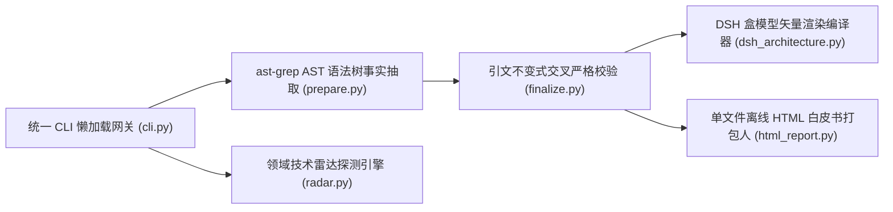

# Li-Sanze/hubradar @ `93ef1e15` · 3 分钟卡片
> 覆盖：full_scan（源码 10 文件）· 证据包约 14,505 tokens / 全量约 24,345 · 结论校验 16/16 通过

**本质**：HubRadar = 静态 AST 拓扑提取 + 引文不变式交叉严格校验 + 领域技术雷达探测 + DSH 交互式矢量架构白皮书引擎。 [源码事实✓ cli.py#L44](https://github.com/Li-Sanze/hubradar/blob/93ef1e15c8e79c0a5a337e19624b002ef7906cbb/hubradar/cli.py#L44-L88) [源码事实✓ prepare.py#L166](https://github.com/Li-Sanze/hubradar/blob/93ef1e15c8e79c0a5a337e19624b002ef7906cbb/hubradar/prepare.py#L166-L248) [源码事实✓ finalize.py#L153](https://github.com/Li-Sanze/hubradar/blob/93ef1e15c8e79c0a5a337e19624b002ef7906cbb/hubradar/finalize.py#L153-L180) [源码事实✓ dsh_architecture.py#L78](https://github.com/Li-Sanze/hubradar/blob/93ef1e15c8e79c0a5a337e19624b002ef7906cbb/hubradar/dsh_architecture.py#L78-L150)

**解决**：告别盲目造轮子与营销刷星，3 分钟看穿任意开源代码库的真实架构、承重模式与踩坑避坑决策，输出零依赖交互白皮书。  
**不解决**：不替代完整工程代码生成，不运行不可信的目标源码（坚持严格只读 AST 静态提取）。

## 核心系统架构全景
```dsh-architecture
{
  "slug": "hubradar",
  "title": "HubRadar 核心系统架构与全景分层 (93ef1e1)",
  "subtitle": "统一 CLI / 双 Skill 接入 · 静态 AST 与引文不变式验证内核 · DSH 矢量渲染与离线打包底座",
  "layers": [
    {
      "id": "presentation",
      "name": "入口与交互呈现平面 (Presentation & CLI / Agent Skill Plane)",
      "cards": [
        {
          "id": "cli",
          "title": "统一 CLI 懒加载网关 (cli.py)",
          "desc": "lazy-import 分流五大子命令与流水线",
          "color": "blue",
          "href": "https://github.com/Li-Sanze/hubradar/blob/93ef1e15c8e79c0a5a337e19624b002ef7906cbb/hubradar/cli.py#L44-L88"
        },
        {
          "id": "skills",
          "title": "宿主双 Agent Skill 协议 (skills/)",
          "desc": "3 分钟卡片与技术雷达 双规范交互契约",
          "color": "yellow",
          "href": "https://github.com/Li-Sanze/hubradar/blob/93ef1e15c8e79c0a5a337e19624b002ef7906cbb/skills/hubradar/SKILL.md#L1-L35"
        },
        {
          "id": "report-ui",
          "title": "交互缩放与深浅色控制器 (assets/)",
          "desc": "CSS 变量双模自适应 · 零依赖无级缩放",
          "color": "purple",
          "href": "https://github.com/Li-Sanze/hubradar/blob/93ef1e15c8e79c0a5a337e19624b002ef7906cbb/hubradar/assets/report.js#L125-L175"
        }
      ]
    },
    {
      "id": "analysis",
      "name": "静态证据与引文验证内核 (Analysis & Invariant Verification Kernel)",
      "cards": [
        {
          "badge": "1",
          "id": "prepare",
          "title": "ast-grep 语法树事实抽取",
          "desc": "多语言 AST census · 调用图与核心文件评分",
          "code_pill": "top_defs(root, lang) & nx.DiGraph()",
          "color": "blue",
          "href": "https://github.com/Li-Sanze/hubradar/blob/93ef1e15c8e79c0a5a337e19624b002ef7906cbb/hubradar/prepare.py#L190-L225"
        },
        {
          "badge": "2",
          "id": "verify",
          "title": "引文不变式交叉严格校验",
          "desc": "校验 claims 证据链 · 源码行逐字引文回溯",
          "code_pill": "verify(facts, raw, repo)",
          "color": "purple",
          "href": "https://github.com/Li-Sanze/hubradar/blob/93ef1e15c8e79c0a5a337e19624b002ef7906cbb/hubradar/finalize.py#L53-L88"
        },
        {
          "badge": "3",
          "id": "radar",
          "title": "领域技术雷达探测引擎",
          "desc": "突破性开源新星扫描 · 采纳四象限矩阵分析",
          "code_pill": "build_radar(domain_spec)",
          "color": "emerald",
          "href": "https://github.com/Li-Sanze/hubradar/blob/93ef1e15c8e79c0a5a337e19624b002ef7906cbb/hubradar/radar.py#L15-L60"
        }
      ]
    },
    {
      "id": "output",
      "name": "矢量渲染与离线打包底座",
      "cards": [
        {
          "id": "svg",
          "title": "DSH 盒模型矢量渲染编译器 (dsh_architecture.py)",
          "desc": "1000px 黄金视口 · 正交连线避让 · 代码药丸与 GitHub SHA 点击直达",
          "code_pill": "generate_dsh_svg(spec_data)",
          "pill_desc": "原生纯 Python 吸收 · 零外部 Node/CLI 依赖",
          "color": "emerald",
          "href": "https://github.com/Li-Sanze/hubradar/blob/93ef1e15c8e79c0a5a337e19624b002ef7906cbb/hubradar/dsh_architecture.py#L78-L150"
        },
        {
          "id": "html",
          "title": "单文件离线 HTML 白皮书打包人 (html_report.py)",
          "desc": "Markdown 解析 · Bleach 安全占位内联 · 零脚本纯矢量自适应",
          "code_pill": "render_file(card_md, index_html)",
          "pill_desc": "彻底剥离 3.4MB mermaid.js 强依赖 · 毫秒级加载与离线归档",
          "color": "purple",
          "href": "https://github.com/Li-Sanze/hubradar/blob/93ef1e15c8e79c0a5a337e19624b002ef7906cbb/hubradar/html_report.py#L145-L185"
        }
      ]
    }
  ],
  "edges": [
    {
      "from": "cli",
      "to": "prepare",
      "style": "dashed"
    },
    {
      "from": "cli",
      "to": "verify",
      "style": "dashed"
    },
    {
      "from": "cli",
      "to": "radar",
      "style": "dashed"
    },
    {
      "from": "skills",
      "to": "prepare",
      "style": "dashed"
    },
    {
      "from": "skills",
      "to": "radar",
      "style": "dashed"
    },
    {
      "from": "prepare",
      "to": "verify"
    },
    {
      "from": "verify",
      "to": "html"
    },
    {
      "from": "radar",
      "to": "html"
    },
    {
      "from": "svg",
      "to": "html"
    },
    {
      "from": "html",
      "to": "report-ui"
    }
  ],
  "legend": {
    "items": [
      {
        "label": "接入与呈现 (Presentation & CLI)",
        "color": "#2563eb"
      },
      {
        "label": "静态分析与验证 (Kernel & Verification)",
        "color": "#7c3aed"
      },
      {
        "label": "矢量渲染与打包 (Vector & Packaging)",
        "color": "#059669"
      },
      {
        "label": "点击直达 GitHub 源码提交行 (Click-to-Source)",
        "color": "#64748b"
      }
    ]
  },
  "summary_note": "纯 Python 原生吸收 · 零 Node/CLI 外部依赖 · 节点点击直达 GitHub 93ef1e1 源码提交行"
}
```

<details><summary>查看 Mermaid 原始备用流图</summary>



</details>

## 核心抽象
| 抽象 | 职责 | 证据 |
|---|---|---|
| prepare (事实抽取) | 从 Git HEAD 抽取 AST 符号、调用图、依赖关系与 40 位 SHA 证据包 | [源码事实✓ prepare.py#L166](https://github.com/Li-Sanze/hubradar/blob/93ef1e15c8e79c0a5a337e19624b002ef7906cbb/hubradar/prepare.py#L166-L248) |
| finalize (校验收口) | 严格复核 LLM 提取的 claims 引文区间，验证通过后产出白皮书卡片 | [源码事实✓ finalize.py#L153](https://github.com/Li-Sanze/hubradar/blob/93ef1e15c8e79c0a5a337e19624b002ef7906cbb/hubradar/finalize.py#L153-L180) |
| radar (领域探测) | 追踪领域突破性黑马项目，自动补全 GitHub 信号与四象限矩阵 | [源码事实✓ radar.py#L15](https://github.com/Li-Sanze/hubradar/blob/93ef1e15c8e79c0a5a337e19624b002ef7906cbb/hubradar/radar.py#L15-L60) |
| dsh_architecture (出图编译器) | 原生纯 Python 渲染 1000px C4 矢量架构图，支持代码穿透与深浅色 | [源码事实✓ dsh_architecture.py#L78](https://github.com/Li-Sanze/hubradar/blob/93ef1e15c8e79c0a5a337e19624b002ef7906cbb/hubradar/dsh_architecture.py#L78-L150) |
