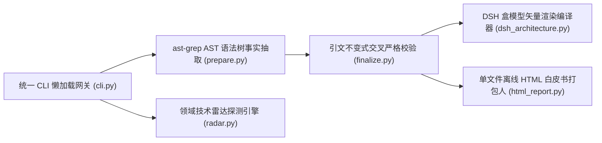

# Li-Sanze/hubradar @ `93ef1e15` · 3 分钟卡片
> 覆盖：full_scan（源码 10 文件）· 证据包约 14,505 tokens / 全量约 24,345 · 结论校验 16/16 通过

**本质**：HubRadar = 静态 AST 拓扑提取 + 引文不变式交叉严格校验 + 领域技术雷达探测 + DSH 交互式矢量架构白皮书引擎。 [源码事实✓ cli.py#L44](https://github.com/Li-Sanze/hubradar/blob/93ef1e15c8e79c0a5a337e19624b002ef7906cbb/hubradar/cli.py#L44-L88) [源码事实✓ prepare.py#L166](https://github.com/Li-Sanze/hubradar/blob/93ef1e15c8e79c0a5a337e19624b002ef7906cbb/hubradar/prepare.py#L166-L248) [源码事实✓ finalize.py#L153](https://github.com/Li-Sanze/hubradar/blob/93ef1e15c8e79c0a5a337e19624b002ef7906cbb/hubradar/finalize.py#L153-L180) [源码事实✓ dsh_architecture.py#L78](https://github.com/Li-Sanze/hubradar/blob/93ef1e15c8e79c0a5a337e19624b002ef7906cbb/hubradar/dsh_architecture.py#L78-L150)

**解决**：告别盲目造轮子与营销刷星，3 分钟看穿任意开源代码库的真实架构、承重模式与踩坑避坑决策，输出零依赖交互白皮书。  
**不解决**：不替代完整工程代码生成，不运行不可信的目标源码（坚持严格只读 AST 静态提取）。

## 核心系统架构全景
```dsh-architecture
hubradar
```

<details><summary>查看 Mermaid 原始备用流图</summary>



</details>

## 核心抽象
| 抽象 | 职责 | 证据 |
|---|---|---|
| prepare (事实抽取) | 从 Git HEAD 抽取 AST 符号、调用图、依赖关系与 40 位 SHA 证据包 | [源码事实✓ prepare.py#L166](https://github.com/Li-Sanze/hubradar/blob/93ef1e15c8e79c0a5a337e19624b002ef7906cbb/hubradar/prepare.py#L166-L248) |
| finalize (校验收口) | 严格复核 LLM 提取的 claims 引文区间，验证通过后产出白皮书卡片 | [源码事实✓ finalize.py#L153](https://github.com/Li-Sanze/hubradar/blob/93ef1e15c8e79c0a5a337e19624b002ef7906cbb/hubradar/finalize.py#L153-L180) |
| radar (领域探测) | 追踪领域突破性黑马项目，自动补全 GitHub 信号与四象限矩阵 | [源码事实✓ radar.py#L15](https://github.com/Li-Sanze/hubradar/blob/93ef1e15c8e79c0a5a337e19624b002ef7906cbb/hubradar/radar.py#L15-L60) |
| dsh_architecture (出图编译器) | 原生纯 Python 渲染 1000px C4 矢量架构图，支持代码穿透与深浅色 | [源码事实✓ dsh_architecture.py#L78](https://github.com/Li-Sanze/hubradar/blob/93ef1e15c8e79c0a5a337e19624b002ef7906cbb/hubradar/dsh_architecture.py#L78-L150) |
