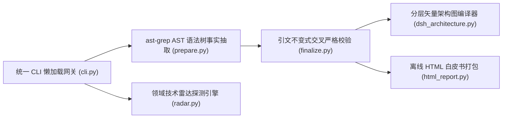

# Li-Sanze/hubradar @ `93ef1e15` · 3 分钟卡片
> 覆盖：full_scan（源码 10 文件）· 证据包约 14,505 tokens / 全量约 24,345 · 结论校验 16/16 通过

**本质**：HubRadar = 静态 AST 拓扑提取 + 引文不变式交叉严格校验 + 领域技术雷达探测 + 分层矢量架构图与离线白皮书引擎。 [源码事实✓ cli.py#L44](https://github.com/Li-Sanze/hubradar/blob/93ef1e15c8e79c0a5a337e19624b002ef7906cbb/hubradar/cli.py#L44-L88) [源码事实✓ prepare.py#L166](https://github.com/Li-Sanze/hubradar/blob/93ef1e15c8e79c0a5a337e19624b002ef7906cbb/hubradar/prepare.py#L166-L248) [源码事实✓ finalize.py#L150](https://github.com/Li-Sanze/hubradar/blob/93ef1e15c8e79c0a5a337e19624b002ef7906cbb/hubradar/finalize.py#L150-L170) [源码事实✓ dsh_architecture.py#L78](https://github.com/Li-Sanze/hubradar/blob/93ef1e15c8e79c0a5a337e19624b002ef7906cbb/hubradar/dsh_architecture.py#L78-L150)

**解决**：告别盲目造轮子与营销刷星，3 分钟看穿任意开源代码库的真实架构、承重模式与踩坑避坑决策，输出零依赖交互白皮书。  
**不解决**：不替代完整工程代码生成，不运行不可信的目标源码（坚持严格只读 AST 静态提取）。

## 核心系统架构全景
```dsh-architecture
{
  "slug": "hubradar",
  "title": "HubRadar 核心系统架构与工作流全景 (93ef1e1)",
  "subtitle": "统一 CLI / Agent Skill 双入口 · 双轮分析与验证内核 · 零依赖离线交付",
  "layers": [
    {
      "id": "presentation",
      "name": "使用入口与调度平面 (Presentation & CLI / Agent Skill Plane)",
      "cards": [
        {
          "id": "cli",
          "title": "统一 CLI 懒加载网关 (cli.py)",
          "desc": "lazy-import 分流五大子命令与完整流水线",
          "color": "blue",
          "href": "https://github.com/Li-Sanze/hubradar/blob/93ef1e15c8e79c0a5a337e19624b002ef7906cbb/hubradar/cli.py#L44-L88"
        },
        {
          "id": "skills",
          "title": "宿主双 Agent Skill 协议 (skills/)",
          "desc": "3 分钟卡片与技术雷达 双规范交互契约",
          "color": "blue",
          "href": "https://github.com/Li-Sanze/hubradar/blob/93ef1e15c8e79c0a5a337e19624b002ef7906cbb/skills/hubradar/SKILL.md#L1-L35"
        }
      ]
    },
    {
      "id": "analysis",
      "name": "双轮分析与验证内核 (Analysis & Invariant Verification Kernel)",
      "cards": [
        {
          "badge": "1",
          "id": "distill",
          "title": "代码库 3 分钟白皮书流水线",
          "desc": "AST 抽取 ➔ Agent 提炼 ➔ 校验 ➔ 输出 card.md",
          "code_pill": "prepare() ➔ Agent ➔ finalize()",
          "pill_desc": "严格代码引文逐字回溯",
          "color": "purple",
          "href": "https://github.com/Li-Sanze/hubradar/blob/93ef1e15c8e79c0a5a337e19624b002ef7906cbb/hubradar/finalize.py#L53-L170"
        },
        {
          "badge": "2",
          "id": "radar",
          "title": "领域开源技术雷达引擎",
          "desc": "开源新星扫描 · 六类梯队分层 · 输出 radar.md",
          "code_pill": "main(domain_file, out_dir)",
          "pill_desc": "多源开源信号探测 · 极速生成",
          "color": "purple",
          "href": "https://github.com/Li-Sanze/hubradar/blob/93ef1e15c8e79c0a5a337e19624b002ef7906cbb/hubradar/radar.py#L70-L115"
        }
      ]
    },
    {
      "id": "output",
      "name": "矢量渲染与离线打包底座 (Vector Rendering & Offline Packaging)",
      "cards": [
        {
          "id": "svg",
          "title": "分层矢量架构图编译器 (dsh_architecture.py)",
          "desc": "纯 Python 零依赖 · 1000px 分层矢量图编译",
          "code_pill": "generate_dsh_svg(spec_data)",
          "pill_desc": "声明式 JSON 编译为 SVG",
          "color": "emerald",
          "href": "https://github.com/Li-Sanze/hubradar/blob/93ef1e15c8e79c0a5a337e19624b002ef7906cbb/hubradar/dsh_architecture.py#L78-L150"
        },
        {
          "id": "html",
          "title": "零依赖交互式白皮书打包 (html_report.py)",
          "desc": "单文件离线打包 · 内嵌 CSS/JS · 输出 index.html",
          "code_pill": "render_file(card_md, index_html)",
          "pill_desc": "浏览器极速秒开 · 支持无级缩放",
          "color": "emerald",
          "href": "https://github.com/Li-Sanze/hubradar/blob/93ef1e15c8e79c0a5a337e19624b002ef7906cbb/hubradar/html_report.py#L145-L154"
        }
      ]
    }
  ],
  "edges": [
    {
      "from": "cli",
      "to": "distill"
    },
    {
      "from": "cli",
      "to": "radar"
    },
    {
      "from": "skills",
      "to": "distill"
    },
    {
      "from": "skills",
      "to": "radar"
    },
    {
      "from": "distill",
      "to": "svg"
    },
    {
      "from": "distill",
      "to": "html"
    },
    {
      "from": "radar",
      "to": "html"
    },
    {
      "from": "svg",
      "to": "html"
    }
  ],
  "legend": {
    "items": [
      {
        "label": "使用入口 (Presentation & CLI)",
        "color": "#2563eb"
      },
      {
        "label": "双轮分析与验证 (Kernel & Verification)",
        "color": "#7c3aed"
      },
      {
        "label": "矢量渲染与打包 (Vector & Packaging)",
        "color": "#059669"
      },
      {
        "label": "点击直达 GitHub 源码提交行 (Click-to-Source)",
        "color": "#64748b"
      }
    ]
  },
  "summary_note": "Python 标准库原生编译 SVG · 实线箭头表示核心数据流动 · 点击直达固定提交 93ef1e1 源码行"
}
```

<details><summary>查看 Mermaid 原始备用流图</summary>



</details>

## 核心抽象
| 抽象 | 职责 | 证据 |
|---|---|---|
| prepare (事实抽取) | 从 Git HEAD 抽取 AST 符号、调用图、依赖关系与 40 位 SHA 证据包 | [源码事实✓ prepare.py#L166](https://github.com/Li-Sanze/hubradar/blob/93ef1e15c8e79c0a5a337e19624b002ef7906cbb/hubradar/prepare.py#L166-L248) |
| finalize (校验收口) | 严格复核 LLM 提取的 claims 引文区间，验证通过后产出白皮书卡片 | [源码事实✓ finalize.py#L150](https://github.com/Li-Sanze/hubradar/blob/93ef1e15c8e79c0a5a337e19624b002ef7906cbb/hubradar/finalize.py#L150-L170) |
| radar (领域探测) | 追踪领域突破性黑马项目，自动补全 GitHub 信号与四象限矩阵 | [源码事实✓ radar.py#L15](https://github.com/Li-Sanze/hubradar/blob/93ef1e15c8e79c0a5a337e19624b002ef7906cbb/hubradar/radar.py#L15-L60) |
| dsh_architecture (出图编译器) | 原生纯 Python 渲染 1000px 分层矢量架构图，支持代码穿透与深浅色 | [源码事实✓ dsh_architecture.py#L78](https://github.com/Li-Sanze/hubradar/blob/93ef1e15c8e79c0a5a337e19624b002ef7906cbb/hubradar/dsh_architecture.py#L78-L150) |
